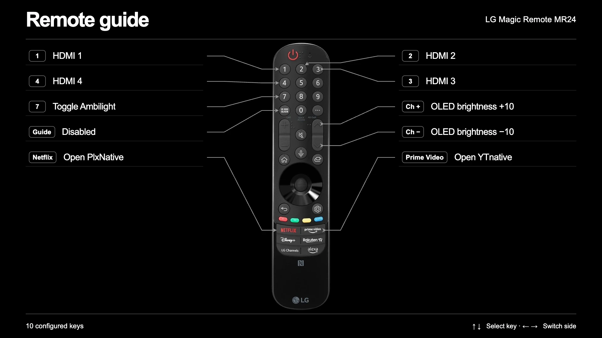

# Remote Guide for webOS

See what each remapped button on your LG Magic Remote does. Remote Guide puts your current Magic Mapper shortcuts beside a photograph of the European MR24 and draws an arrow to each physical key. Move the pointer or use the D-pad to highlight a key and see its tap or hold behavior.



## How it works

When Magic Mapper loads its configuration, a Python helper writes button names, action descriptions and press details into the installed web app. Remote Guide reads that file when opened, when it returns to the foreground and every 15 seconds while visible. Browsing the guide never executes a shortcut. Buttons outside the photographed layout still appear as text entries.

## Build and install

You need the webOS CLI on your computer and a TV with Python 3, shell access and an existing Magic Mapper installation. The installer supports the file-based mapper that loads its JSON configuration into `button_map` in `get_button_map()`. It checks for that loader before applying its hook.

1. Package the web app from the repository root.

   ```sh
   mkdir -p dist
   ares-package app --no-minify -o dist
   ```

2. Install the resulting IPK using your usual webOS package installer. With a configured webOS CLI device named `my-tv`, use `ares-install -d my-tv dist/*.ipk`.
3. Copy the `mapper` directory to a temporary directory on the TV and run `python3 mapper/install.py` there with permission to update Magic Mapper. The installer saves a backup before editing its loader and generates the first set of labels immediately. Run it again after reinstalling the IPK.
4. Open **Remote Guide** from the TV’s app list.

## Customize labels

Optional JSON files beside the Python installer let you name HDMI inputs, scripts and webhooks. They stay local and are ignored by Git. For example, this `guide-labels.json` gives HDMI 2 a descriptive name.

```json
{
  "inputs": {"2": "Game console"}
}
```

The same file accepts a `device` string for the header and a `scripts` object mapping script paths to display names. A separate `webhook-labels.json` maps the SHA-256 digest of each complete webhook URL, encoded as UTF-8, to a display name. An unknown webhook gets a generic label. Run the installer again to publish your updated labels.

## Development

Run `python3 -m unittest discover -s tests` to check the mapping exporter.

The remote photograph is from [LG’s MR24GN product gallery](https://www.lg.com/pl/telewizory-i-soundbary/akcesoria/akb76045103/). The button mappings come from [Magic Mapper](https://github.com/andrewfraley/magic_mapper).
